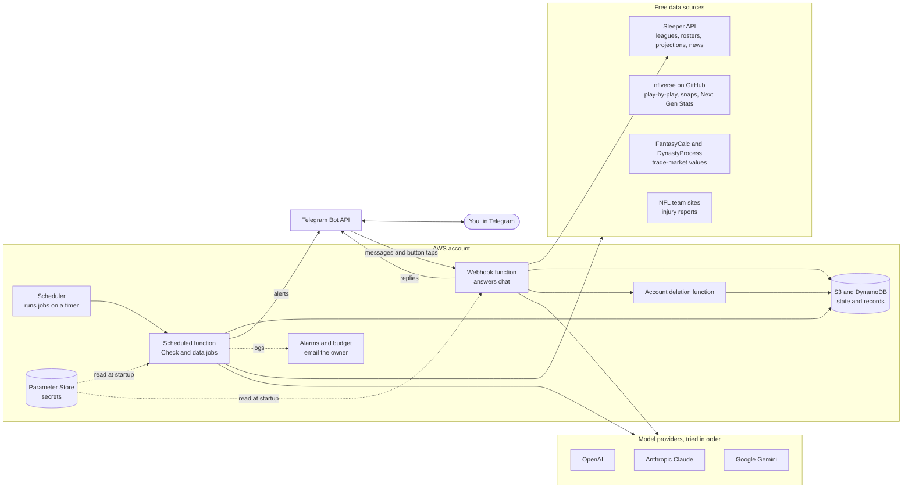
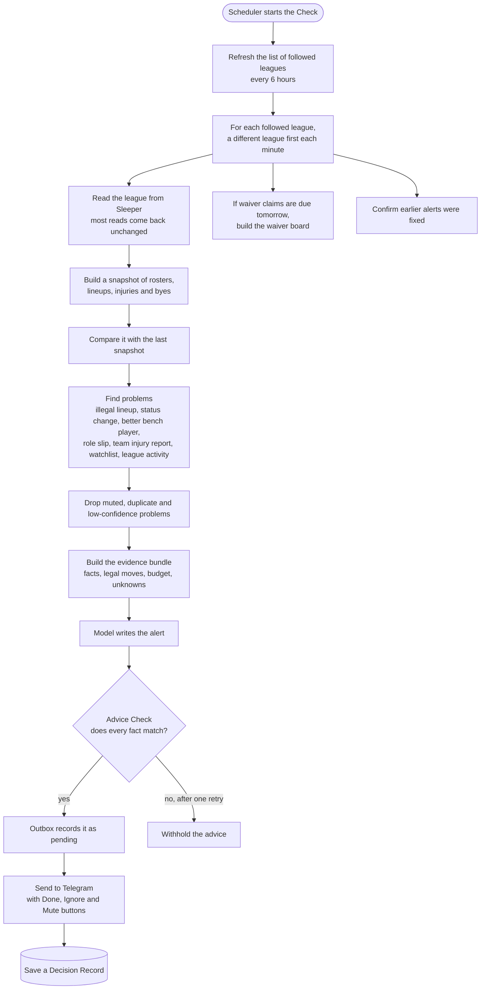
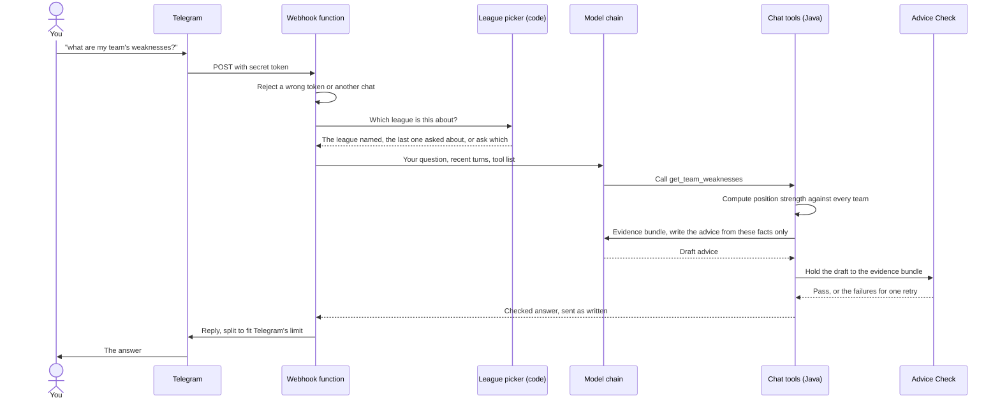
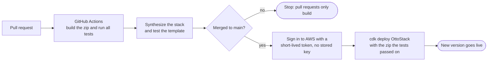

# How Otto is built

Otto is a fantasy football assistant that runs on AWS for one person. It follows every Sleeper league that person plays in, sends alerts to a Telegram chat, and answers questions in that chat. This page explains how the pieces fit together and why they are shaped the way they are. The decisions behind each part are recorded in [docs/adr/](adr/).

One rule shapes most of the design: **code computes every number, and the model only explains.** Projections, ranks, trade values, FAAB bids and the legal lineup moves all come from Java. A language model turns those facts into a short message, and a check in code holds the message to the facts before anyone reads it.

## The big picture

Otto is one Java application deployed as three AWS Lambda functions. It reads free data sources, keeps its state in S3 and DynamoDB, and talks to the owner through a Telegram bot.

There are two ways in:

- **The Check** runs once a minute on a schedule. It is how Otto notices things and texts you first.
- **The Ask loop** runs when you send a message or tap a button. Telegram posts the update to a Lambda function URL, and Otto answers in the chat.

Both use the same code and the same storage. Locally, one Spring Boot process does both: a timer runs the Check, Telegram is read by long polling, and state goes to JSON files under `./data` ([ADR-0007](adr/0007-local-telegram-delivery.md)).

## The Check, once a minute

The Check is a fixed pipeline. Code does every step except writing the words of an alert.

A few details matter here:

- **Problems are found in code.** Each detector looks at the snapshot or the diff and returns problems with a confidence level. A starter ruled out is a certainty. A bench player who projects higher is an estimate, so the alert gives both numbers ([ADR-0001](adr/0001-lineup-guardrail-alert-semantics.md)).
- **One problem means one message.** Problems about the same player merge. The Lock Ladder allows one alert when Otto finds the problem and one last warning in the half hour before that player's game locks. Nothing comes after lock.
- **An alert is sent once.** The outbox marks a delivery as pending before Telegram is called, and as sent after Telegram accepts it. If a Lambda dies between the two, the next Check rebuilds the alert from what is true then, and sends it, rewrites it or cancels it ([ADR-0010](adr/0010-alert-delivery-outbox.md)).
- **The model has a time budget.** All model calls in one Check share 240 seconds, inside the function's 300-second timeout. A model call starts only if its whole deadline still fits. Anything left over waits for the next minute.
- **Leagues take turns.** Every league runs inside one Check. The league that goes first moves along the list each minute, so one league can't use up the model budget every time ([ADR-0012](adr/0012-follow-every-league.md)).

### The waiver board

The waiver board is the largest thing the Check builds. At 6 p.m. Pacific on the day before a league's claims run, Otto screens every free agent and collects evidence from several sources: projections, usage, matchups, news and Sleeper's trending adds. The model ranks the candidates and proposes FAAB bids. Code checks the board, including that every bid fits inside bounds it computed from the budget you have left. The top five go out, and a **View all options** button shows the rest.

If the latest week's stats are late, the board waits. Three hours before the deadline, it fills the gap from Sleeper's stats or goes out with a note saying what is missing. Each week, Otto also builds simpler baseline boards and later scores every board on what its pickups added to your lineup, so the evidence-based board can be judged and rolled back ([ADR-0006](adr/0006-waivers-and-faab.md)).

## The Ask loop, when you send a message

A chat answer is a tool-calling loop. The model chooses from 28 tools, and each tool is Java that reads stored data and computes the answer.

The tools fall into two kinds:

- **Fact tools** return computed data, such as the roster, the standings, a player's news or a league's scoring settings. The chat model reads the data and writes a short reply.
- **Advice tools** build an evidence bundle and have the model write the advice inside the tool, held by the Advice Check. Lineup advice, team weaknesses, trade offers, market values, buy-low and sell-high, player ceilings, stat answers and habits work this way. When the advice tool is the only tool the model called, Otto sends the checked text unchanged.

`AskToolNamesTest` lists every tool name, so adding or renaming a tool is a deliberate change.

### Which league a question is about

Code picks the league before the model runs, so the choice costs nothing and works when every model is down. A message that names a league ("my dynasty league") is about that league. "All my leagues" answers once per league, with the answers written at the same time on separate threads. Otherwise the question goes to the league the chat was last about, within 24 hours. If none of those apply and Otto follows more than one league, it asks which one ([ADR-0012](adr/0012-follow-every-league.md)).

The league is bound for the length of the work as a Java `ScopedValue`. Every Sleeper read and every stored document takes its league from that binding. This change touched four places in the code instead of the signature of nearly every service.

## The Advice Check

The Advice Check is the step that makes "the model only explains" true. Before a model-written answer is sent, the check compares it with the evidence bundle it was written from. It checks:

- Every player name and identity.
- Every number, every rank written as an ordinal such as "3rd", and every comparison.
- The recommended move, against the list of moves code verified as legal.
- Every dollar amount, against the verified budget.
- That the advice is conditional on every fact no source supplied, such as an unknown return date.
- That every claim cites evidence that supports it.
- The voice and the length limit. For example, no confidence labels and no "lock".

A failed answer goes back to the model once, with the specific failures. If the second answer fails too, Otto rejects it. Code never patches a failed answer ([ADR-0001](adr/0001-lineup-guardrail-alert-semantics.md)).

Every recommendation run also leaves a Decision Record in S3: what Otto knew, what it computed, what the model said and what was sent. Records are written once and never replaced, so advice can be judged later against what happened.

## Model fallback

`ModelChain` is the one way Otto calls a model. It tries OpenAI, then Anthropic Claude, then Google Gemini, one at a time. A fallback provider is paid for only when every provider before it failed.

- Each provider has a circuit breaker. After three failures in a row, Otto skips that provider for five minutes, then tries one call.
- Each kind of call has a deadline: 45 seconds for a chat answer, 150 seconds for advice and 30 seconds for phrasing an alert. The chain holds back time for later providers, so one provider that hangs can't use the whole deadline.
- When every provider fails, Otto sends a short message that code writes instead of a guess.

## On AWS

One CDK stack in Java, [`OttoStack`](../infra/src/main/java/otto/infra/OttoStack.java), holds everything ([ADR-0008](adr/0008-aws-deployment.md)).

| Piece | What it does |
| --- | --- |
| Scheduled function | Runs the Check and the data jobs. Java 25 on arm64, 1024 MB, 300-second timeout, one run at a time. |
| Webhook function | Answers Telegram through a Lambda function URL. 60-second timeout. |
| Account deletion function | Deletes a user's Decision Records when `/deleteaccount` is confirmed. It is the only role that can. |
| EventBridge Scheduler | The Check every minute, nflverse feeds every hour, defense-versus-position rankings every night at 3:30 a.m. Pacific, news every 10 minutes, team injury reports every 5 minutes, and market values every hour. |
| S3 documents bucket | Documents that grow with the season, such as snapshots, the player directory and the event log, plus the nflverse feeds. Versioned, with old versions kept for 7 days. |
| DynamoDB table | Small records, one item each, such as settings, the watchlist, the conversation, alert deliveries, the news cache and market values. Pay per request, with point-in-time recovery. |
| S3 Decision Records bucket | One record per recommendation run. Object Lock in governance mode, and writes that can only create, never replace. Copied article text expires after 3 seasons by default. |
| Parameter Store | The bot token, chat id, webhook secret and model keys, as SecureStrings read once at startup. |
| CloudWatch alarms | An error alarm on `ERROR` log lines, and a heartbeat alarm that fires if the Check stops logging for 15 minutes. Both email the owner. Logs are kept for 14 days. |
| AWS Budget | Emails at 80% of $20 a month spent, and when the forecast passes $20. |

Both main functions use SnapStart, which starts a function from a saved snapshot of the running app instead of booting Spring each time. SnapStart only works on a published version, so the schedules and the function URL point at a `live` alias.

The stack leaves out API Gateway, Secrets Manager, a database, a VPC, containers, queues and a dev stage. One bot needs one public endpoint, and there is one user. `OttoStackTest` asserts that each of these is absent, so adding one by accident fails a test.

## Deploy on merge

Merging to `main` is what deploys ([ADR-0009](adr/0009-deploy-on-merge.md)).

- The deploy job installs the exact zip the build job tested, instead of building a new one.
- GitHub Actions holds no AWS key. It signs in through OpenID Connect to a role that trusts one repository and one branch.
- That role lives in a second stack, `OttoDeployRoleStack`, which only a person deploys. The pipeline can't widen its own permissions.
- Deploys run one at a time, so two merges close together can't race.

## How it's tested

The tests run the real application. Each scenario test boots the full Spring context and calls the same entry points production uses: the Check, the webhook and the scheduled jobs. WireMock servers stand in for Sleeper, Telegram, nflverse, the team sites, FantasyCalc and the model, replaying recorded responses. Storage goes to a fresh temporary directory, and the clock is fixed, so a test of "30 minutes before kickoff" moves the clock instead of waiting.

- `mvn test` runs about 1,050 tests in the app and makes no network calls.
- `mvn -f infra/pom.xml test` synthesizes the CDK template and checks what it promises: the schedules, the alarms, the bucket rules and the things that must be absent.
- `mvn test -Preal-model` runs about 30 scenario tests against the real model with your `OPENAI_API_KEY`. They judge the decisions and structured fields the model produced, never its wording. Each reply goes on a review sheet at `target/real-model-owner-review.md` so a person can check the voice.
- The multi-league tests run a redraft league and a dynasty league side by side, and every single-league test still passes unchanged.

## What it costs

- **AWS.** The Budget alerts at $20 a month. What actually limits the spend is the one-at-a-time limit on the scheduled function, the 14-day log retention and the 7-day limit on old document versions. Most Sleeper reads in a Check return `304 Not Modified`.
- **Models.** Otto calls a model only when an alert or a waiver board is about to go out, or when you ask a question. League choice, the `/leagues` commands and the league heading are code. An alert resent after a failure reuses the text it already wrote. The main model runs with reasoning turned off, because the thinking is done in Java.
- **Data.** Every source is free. FantasyCalc and DynastyProcess are each asked at most once a day ([ADR-0011](adr/0011-player-market-values.md)).

## Where things live in the code

Packages under `src/main/java/otto` are grouped by feature.

| Package | What it holds |
| --- | --- |
| `check`, `snapshot`, `events` | The Check loop, snapshots and the diff between them |
| `alerts`, `delivery`, `settings` | The detectors, alert sending, the outbox, mutes and settings |
| `ask` | The Ask loop and its 28 tools |
| `advice`, `records` | Evidence bundles, the Advice Check and Decision Records |
| `board`, `waivers`, `claims` | The waiver board, FAAB bids and claim rounds |
| `lineup`, `decisions`, `needs`, `team` | Lineup optimizing, player decisions and roster needs |
| `trade`, `offers`, `market`, `buysell`, `keeper` | Trade pricing, trade offers, market values, buy-low and sell-high, keeper costs |
| `matchup`, `ceiling`, `habits` | Matchup ranks, player ceilings and manager habits |
| `sleeper`, `nflverse`, `research`, `directory` | Data sources, the news cache and the player directory |
| `followed`, `league` | Multiple leagues and each league's rules |
| `model` | `ModelChain`, the provider fallback |
| `telegram`, `aws`, `storage`, `account` | Telegram, the Lambda handlers, storage backends and account deletion |
